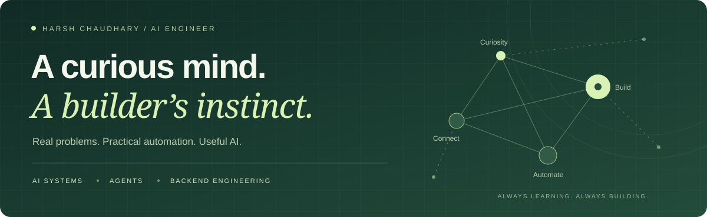

  

  <strong>AI Engineer · Agentic AI · Generative AI · AI-powered backend systems</strong> 
  Bengaluru, India

  <a href="https://harsh-chaudhary-ai.netlify.app/"><strong>Explore my portfolio ↗</strong></a> &nbsp;·&nbsp;
  <a href="https://www.linkedin.com/in/harsh-chaudhary06/">LinkedIn</a> &nbsp;·&nbsp;
  <a href="mailto:mr.harsh0606@gmail.com">Email</a> &nbsp;·&nbsp;
  <a href="https://drive.google.com/file/d/1Og-i1E_kDvmrrftUbxlCFO4lb4i2PLKC/view">Résumé</a>

---

### A little about me

I see a repetitive task and start thinking: **can we make this smarter?**

I experiment with AI agents, build practical automation, and turn real-world problems into systems that help people get more done. I enjoy the work between an ambitious idea and something people can actually use.

Currently an **AI Engineer at McLaren Strategic Solutions**, building code intelligence, evidence-grounded documentation, and specification-driven modernization workflows. Previously a **Senior Software Engineer at Tata Elxsi**, working on AI-assisted testing, RAG, and cloud automation.

### What I bring to a problem

| Area | How I approach it |
| :--- | :--- |
| **Agents & automation** | Connect models to tools, relevant context, and validation so they can support real engineering tasks. |
| **Knowledge & code intelligence** | Use graphs, source retrieval, and lineage to make complex systems easier to understand. |
| **Backend & delivery** | Build with Python, APIs, and cloud automation to turn useful ideas into working systems. |

### Selected engineering work

**01 / Understand the system, then modernize it**  
At McLaren, my work connects application code, databases, reporting, and ETL into a Neo4j knowledge graph. The same foundation supports evidence-based documentation and component specification packs with dependency-aware implementation plans.

- Analyzed a legacy estate of approximately **30M lines of code**, with a graph of approximately **2.4M nodes and 3.9M relationships**.
- Combined MCP graph tools with targeted source retrieval to ground technical explanations.
- Used deterministic graph logic for component discovery and scheduling, with LLM-assisted behavioral descriptions and repair gates for incomplete output.

**02 / Let agents take on repetitive testing work**  
At Tata Elxsi, built a CrewAI and Gemini unit-test generation framework for Python and C++, covering creation, validation, and coverage analysis. Reported approximately **60% less manual testing effort**.

**03 / Make knowledge accessible and setup repeatable**  
Built enterprise RAG workflows with Mistral 7B and customer-cloud deployment, alongside AWS EC2 orchestration that reduced manual setup effort by approximately **70–80%**.

> These are summaries of professional work. Enterprise source code is not public; scale and impact figures are approximate. Generated specification packs and test scaffolds still require implementation and behavioral validation.

[Read the case studies →](https://harsh-chaudhary-ai.netlify.app/#work) &nbsp;·&nbsp; [View the portfolio source →](https://github.com/mrharsh06/portfolio)

### My toolkit

| | Technologies & practices |
| :--- | :--- |
| **Core engineering** | Python · C++ · FastAPI · REST APIs |
| **AI & agents** | LLMs · MCP · CrewAI · LangChain · Prompt engineering |
| **Retrieval & graphs** | RAG · Neo4j · Cypher · Hugging Face · Code & data lineage |
| **Cloud & quality** | AWS EC2 · AWS Bedrock · Docker · GitHub Actions · Pytest |

### Recognition & knowledge sharing

- **Extra Mile Award** — LLM-agent enhancements to unit-test automation at Tata Elxsi.
- **Customer appreciation** — secure RAG delivery in a customer cloud environment.
- **Publication:** *Accelerating Unit Testing using Generative AI* — Tata Elxsi, October 2024.
- Delivered internal GenAI training and enjoy sharing practical lessons from engineering.

### Beyond the code

Travel stories, guitar, gym, and swimming keep me exploring outside work. I capture moments while travelling and narrate them on **[HarshSaga](https://www.youtube.com/@harshsaga18)**.

I also enjoy tech events, meeting people building with AI, and hearing perspectives that challenge my own. There is always something new to learn.

---

  <strong>Have a real problem worth solving?</strong> 
  Open to conversations about AI engineering, agentic AI, GenAI, and AI-powered backend roles.  
  <a href="mailto:mr.harsh0606@gmail.com">Let's connect ↗</a>

